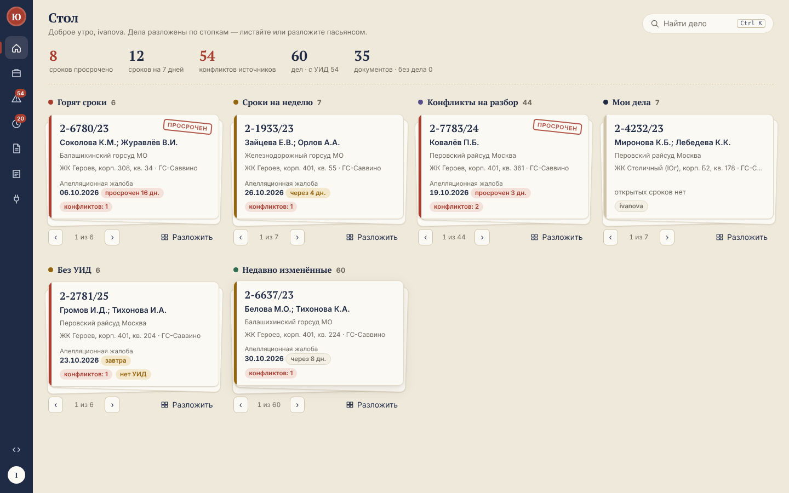

# Рабочее место юриста (lawdesk)

Веб-приложение для юристов, ведущих судебные дела дольщиков, с открытым API. К API подключаются
сервисы системы автоматизации: OCR архива, извлечение моделью, загрузчик писем Почты России,
классификатор актов, синхронизация `sot.db`, интеграция с 1С и т. п.



## Что умеет

| Раздел | Что внутри |
|---|---|
| **Стол** | **лента дней** на две недели (сроки точками по видам, выходные и праздники по календарю 1С, клик — сроки дня); **«чистый стол»** — сколько осталось до нуля конфликтов и просрочек, серия дней без просрочек; **«Моя неделя»** — разобранные конфликты, закрытые сроки, привязанные документы против личных целей и прошлой недели; дела разложены по стопкам («Горят сроки», «Сроки на неделю», «Конфликты на разбор», «Мои дела», «Без УИД», «Недавно изменённые»): листать кнопками/колесом или разложить пасьянсом; клик по карточке открывает дело |
| **Фильтры** | панель фасетов со счётчиками (как в интернет-магазине), общая для дел, конфликтов и сроков: юрлицо, ЖК, корпус, суд, судья (по любому источнику — дела со спорным судьёй находятся по обоим написаниям), год дела, предмет, исход, статус, стадия, ответственный, конфликт по полю, вид открытого срока, документы в деле; переключатели «просрочено / конфликты / УИД / обжалование / документы»; диапазоны дат (срок, решение, изменение) и сумм по любой категории; чипы активных фильтров; **подборки** — сохранённый набор фильтров, выкладывается стопкой на «Стол» |
| **Дела** | переключатель «Карточки / Таблица»; поиск по УИД, любому номеру (М-, 2-, 33-, 88-), истцу, договору; фильтры по юрлицу, корпусу, конфликтам, наличию УИД |
| **Карточка дела** | **путь дела** (иск → решение → апелляция → вступление в силу → кассация → исполнение, текущий этап подсвечен); **присуждено от заявленного** с разбивкой по категориям; вкладка **«Хронология»** — акты, сроки и решения юристов на одной оси; стороны, объект, все номера-псевдонимы; поля со значениями **по каждому источнику** (1С, отчёт, OCR, цифровое письмо) с цитатами и ссылками на страницу документа; документы; сроки; журнал; слияние дублей |
| **Конфликты** | очередь полей, где источники расходятся: выбор значения клавишами `1–9`, `Enter`, `J/K`; своё значение — только с комментарием; признак «возможна апелляция» |
| **Сроки** | считаются автоматически по ГПК РФ из актов дела: апелляция (ст. 321), вступление в силу (ст. 209), кассация (ст. 376.1), частная жалоба (ст. 332, рабочие дни), отмена заочного (ст. 237); перенос с нерабочих дней (ст. 108) по **производственному календарю из 1С**; ручная правка даты отключает автопересчёт |
| **Документы** | скан или цифровой оригинал рядом с текстом и извлечёнными значениями; поиск по тексту; подпись `.sig`; ручная привязка к делу |
| **Командная палитра** | `Ctrl K` или `/` из любого места: дела по номеру/УИД/истцу, «корп 401», «2024», «судья …», «конфликты корп 308», подборки, переходы, действия с открытым делом (назначить меня ответственным, пересчитать сроки), выгрузка для 1С |
| **Журнал** | каждое действие людей и сервисов; решения юристов уходят в ленту изменений для 1С |
| **Сервисы и API** | подключение сервисов, API-ключи (показываются один раз), области доступа, очередь задач, выгрузка XLSX/CSV для 1С, статус календаря, пользователи |

## Как устроено

```
 сервисы конвейера ──REST + API-ключ──▶  FastAPI  ──▶ PostgreSQL
 (1С, Excel, OCR, письма…)  ◀─задачи─┘    │          (дела, поля, наблюдения, документы,
                                             │           сроки, задачи, журнал/лента)
 юристы (браузер, вход AD) ──HTTPS──▶ nginx ─┤
                                             └──▶ хранилище файлов: локально по sha256 → 1С:ДО
 1С / Юрайт  ◀── лента изменений /changes, выгрузка XLSX ──┘
```

* **Дело** — единица учёта; идентичность — УИД, номера дел — псевдонимы. Один номер с разными УИД — разные дела (номер не уникален).
* **Наблюдение** — значение поля от одного источника (+ ключ записи, документ, страница, цитата). Статус поля считается автоматически:
  `confirmed` (≥2 источника согласны), `single`, `conflict`, `appeal_possible` (суммы при признаках обжалования), `resolved` (решение юриста).
  Новое, ранее не виденное значение источника снова открывает решённое поле.
* **Журнал = лента изменений**: номер в ленте присваивается при чтении только зафиксированным событиям, поэтому курсор монотонный и без пропусков.
* **Очередь задач** — в PostgreSQL (`FOR UPDATE SKIP LOCKED`, аренда с продлением, повторы).

**Документация — [docs/README.md](docs/README.md)**: как устроено, коннекторы, обмен с 1С (с кодом на встроенном языке), администрирование, путь к замене 1С.

## Запуск на сервере (Docker)

```bash
cp .env.example .env            # заполнить: пароль БД, LAWDESK_SECRET_KEY, параметры AD и групп
cp /path/lawdesk.crt /path/lawdesk.key certs/
docker compose up -d --build
# первый сервис (например, синхронизация sot.db) — ключ печатается один раз:
docker compose exec backend python -m app.cli service sot-sync --scopes read,ingest
```

Откройте `https://<сервер>/`, войдите доменной учёткой из группы `Lawdesk-Lawyers` / `Lawdesk-Admins` / `Lawdesk-Viewers`.
Документация API: `https://<сервер>/api/docs`.

## Запуск для разработки

```bash
python -m venv .venv && .venv/bin/pip install -r backend/requirements-dev.txt
# PostgreSQL на localhost:5433, базы lawdesk и lawdesk_test (или задайте LAWDESK_DATABASE_URL)
cd backend && LAWDESK_AUTH_MODE=dev ../.venv/bin/uvicorn app.main:app --reload       # API на :8000
cd frontend && npm install && npm run dev                                             # интерфейс на :5173
../.venv/bin/python -m pytest -q                                                       # тесты (backend/)
```

В `dev`-режиме вход — любой логин, пароль `dev`, роль из `LAWDESK_DEV_ROLE` (по умолчанию admin). Не включайте его на сервере.

Демо-данные (вымышленные, без персональных данных): `LAWDESK_KEY=<ключ> python connectors/demo_seed.py`.

## Подключение источников и приёмников (коннекторы)

Обмен с любыми системами — **без программирования**: файл настроек `.toml` + универсальная программа
`connectors/lawdesk_connect.py` (только стандартная библиотека Python 3.11+).

```bash
cd connectors
python lawdesk_connect.py шаблон                                  # список заготовок
python lawdesk_connect.py проверить примеры/csv.toml              # что прочитано и что будет отправлено
python lawdesk_connect.py запустить подключения/мой.toml          # выполнить
```

Источники: CSV, Excel, JSON, папка с файлами, OData (1С и др.), HTTP/JSON, SQLite, любая СУБД через SQL.
Наружу: CSV, JSON, HTTP-сервис (1С, будущая система) — по ленте изменений, без потерь и дублей.
1С — один из источников и приёмников, а не обязательная часть. Подробно — [docs/коннекторы.md](docs/коннекторы.md).

Специализированный `connectors/sot_sync.py` (sot.db конвейера) остаётся для совместимости;
для новых подключений используйте `lawdesk_connect.py` (пример — `примеры/sqlite_sot.toml`).

## Безопасность и данные

* В базе приложения — персональные данные (ФИО истцов, адреса). Разворачивайте только во внутренней сети, с HTTPS.
* Секреты API-ключей хранятся как sha256; ключ отзывается мгновенно.
* В репозиторий не попадают `.env`, сертификаты, хранилище файлов и базы (см. `.gitignore`).
* Каждый просмотр файла документа пишется в журнал.

## Структура

```
backend/app/        FastAPI: models.py (схема), logic.py (дела/поля/решения), deadlines.py (ГПК),
                    security.py (AD, сессии, ключи), storage.py (локально / 1С:ДО), routers/ (API)
backend/tests/      pytest на PostgreSQL
frontend/src/       React + TypeScript (Vite): pages/, components/
connectors/         lawdesk_connect.py (универсальный коннектор), примеры/, подключения/, запуск.bat/.sh,
                    lawdesk_client.py (клиент API без зависимостей), sot_sync.py, demo_seed.py, tests/
docs/               документация (начать с docs/README.md), скриншоты
```
